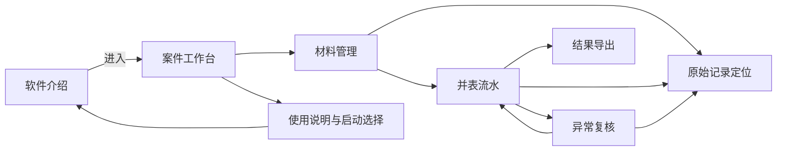

# 04 · 功能设计与页面交互说明

> 项目：东启勘流 / FundSift
>
> 版本：v0.3，2026-11-13，补记用户决定与 M0 实施进度
>
> 状态：**功能设计草案，不是开发完成报告，也不是全部需求已获确认。**
>
> 用户已授权开始构建，并确认首次启动选择数据目录、建案只留名称＋编号。M0 实施与实测记录见 [05-M0桌面骨架与交付](05-M0桌面骨架与交付.md)；其余 Q 项继续保留待决定。

## 1. 阅读方式与依据

本文回答：各页用于什么工作、展示哪些字段、按钮如何操作、结果保存在哪里、异常怎么处理、最后如何验收。

本文使用三种标记，防止把讨论中的方案当成已完成能力：

| 标记 | 含义 |
|---|---|
| **原型现状** | 已阅读当前 HTML/JS 确认的演示行为；数据主要在内存中，不代表真实业务可用 |
| **正式版设计** | 根据已有业务规则整理的目标行为，供本轮审查；通过后才进入实现 |
| **待决定 Qxx** | 现有资料不足或会改变用户操作方式的事项；本文列出建议与选项，不代替用户拍板 |

### 1.1 依据文件

| 依据 | 本文如何使用 |
|---|---|
| [01-项目总览与架构决策](01-项目总览与架构决策.md) | 软件定位、本地桌面、每案一库、分阶段开发范围 |
| [02-金额符号处理规则](02-金额符号处理规则.md) | A～F 分支、冲突、原值保存、整数分、余额口径、待核边界 |
| [03-第一片开发计划-并表闭环](03-第一片开发计划-并表闭环.md) | DDL、有效批次、失败保旧、worker、里程碑、规模与回源验收 |
| [ui-01-介绍首页](ui-01-介绍首页.md) | 已确认的浅色介绍首页、字体、进入与跳过交互 |
| [原型使用说明](../code/prototype/README.md) | 当前可体验页面及实现边界 |
| [app.js](../code/prototype/app.js)、[intro.js](../code/prototype/intro.js)、[data.js](../code/prototype/data.js) | 核对实际按钮、表单、筛选、状态和示例数据行为 |

本文没有重新核验逆向资产的数字、重新跑真实案件，也不沿用这些数字作功能完成度证明。既往 DDL 探针和 HTML 交互检查只证明各自检查范围，不能代替本文的正式功能验收。

### 1.2 冲突与变更规则

金额解释、余额适用条件、有效批次等继承 `02/03` 的现有约束。本文在第 12 节登记数据模型差距；本轮根据用户授权，同步修订 `03` 的待核原因及余额历史 DDL，并以探针检查结构约束。DDL 可建库不等于 worker 已实现业务事务或页面已完成正式验收。

新增交互细化和 Q 项先经审查、再由用户确认。确认后同步本文、受影响的 `02/03`、数据迁移设计和验收用例，不允许只改页面而让数据含义发生变化。

## 2. 本阶段范围与完成状态

### 2.1 第一阶段闭环

**建案 → 登记并导入材料 → 标准化并表 → 核对异常 → 导出并回看来源。**

第一批真实解析范围仍按 `03`：一种银行 XLSX、一种微信 TXT、一种支付宝 CSV，逐格式以黄金样本验收。原型文件选择器允许某扩展名，不构成格式支持承诺。

卷宗覆盖核对、缺口补调、专题汇总、专家规则分析、图谱追踪、报告 PDF、OCR、AI、账号同步仍按已有路线后置，本文件不扩展到这些功能。

### 2.2 交付现状

| 能力 | HTML 原型现状 | 桌面 M0 与后续边界 |
|---|---|---|
| 软件介绍与启动偏好 | 已实现本地浏览器演示 | 桌面沿用介绍页，偏好保存在 Electron 本机用户配置中；打包验收见 05 |
| 案件管理 | 新建、搜索、切换示例案件 | M0 已接入目录选择、工作区索引、每案 SQLite、新建/打开/切换、关闭重开与不可用反馈；不含编辑、归档、删除 |
| 材料导入 | 自选文件只登记名称/大小/类型；示例材料模拟并表 | 读取、哈希、归档、识别、解析、事务、取消与再导 |
| 并表查询 | 内存搜索、筛选、分页和详情 | 数据库查询、大列表、稳定排序与当前批次隔离 |
| 异常复核 | 修改演示状态和两个独立依据字段 | 多原因待核、持久化确认历史、重算影响处理 |
| 回源 | 合成字段及相邻记录预览 | 真实原件副本校验、sheet/逻辑记录定位 |
| 导出 | 有效 XLSX/CSV 示例下载 | 长任务、固定版本读取、超限拆分、落盘与历史文件管理 |

**原型不是验收答案。** 例如原型当前把全部 `pending` 显示成金额待核，正式业务里缺时间、缺账户也会待核，必须按下文细化。

## 3. 全局业务口径

### 3.1 术语与数据身份

| 术语 | 定义 |
|---|---|
| 工作区 | 本机可打开的案件集合；不代表云端账号或多人共享空间 |
| 案件 | 第一阶段的数据隔离单位，按既定方案每案一个 SQLite 数据库 |
| 来源文件 | 案件内按 SHA256 标识的原件身份；同名不同内容是不同文件，同内容改名不重复登记 |
| 导入批次 | 一个文件的一次解析运行；多文件一起选中也分别建批次 |
| 当前有效批次 | `source_file.current_batch_id` 指向的、本案本文件且 `done` 的批次 |
| 当前有效流水 | 属于当前有效批次的记录；历史批次不进入默认查询、汇总和导出 |
| 待核记录 | 有一个或多个阻断原因尚未解决的记录，不只指金额有问题 |
| 余额差异 | 在满足可比条件时发现余额链不平；不自动意味着金额错误 |
| 人工接受差异 | 对一次确定输入版本的余额检查作处理，保留差额和依据，不改交易金额 |

### 3.2 所有页面共用的规则

| 编号 | 规则 |
|---|---|
| BR-01 案件隔离 | 读写、任务、弹窗和导出必须绑定明确案件身份；不能只依赖屏幕当前选中的案件 |
| BR-02 有效版本 | 默认统计只计当前有效流水；失败的新批次不能替换旧有效结果 |
| BR-03 金额精度 | 原始十进制字符串精确转整数分；元→分×100，分→分×1；展示再转元，空值不转零 |
| BR-04 原值不可覆盖 | 人工确认不改原始金额、方向、余额、时间与来源坐标；新解释和确认依据另存 |
| BR-05 确认不猜测 | 字段缺失、未识别方向或不确定口径保留待核；不得靠余额差额倒推并自动改向 |
| BR-06 两类状态独立 | 金额/记录状态与余额检查状态分开；处理一项不顺便解除另一项 |
| BR-07 汇总边界 | 仅 `confirmed` 记录计入收支；`pending` 单独披露，无法量化的记录数单独展示 |
| BR-08 币种隔离 | 不同币种不能相加；首版非 CNY 的支持边界见 Q08，不能用默认 CNY 掩盖已知外币 |
| BR-09 成功有依据 | 数据持久化事务成功后才显示保存成功；浏览器触发下载仅说明文件已生成，不能证明已写入用户磁盘 |
| BR-10 结果可追溯 | 记录能够对应来源身份、来源位置、规则版本、解析器版本和人工处理依据 |
| BR-11 零隐式删除 | 重导、筛选、复核、取消均不得静默删除原件或旧批次；删除类能力没有经确认不开放 |

### 3.3 记录待核与金额状态的关系

沿用现有 `fund_flow.status=confirmed/pending`，但在产品上将其解释为**记录确认状态**。它不能同时代替每一种异常的状态。

正式版设计要求每条待核原因可单独识别，如缺金额、方向未识别、时间不可解释、账户缺失。界面至少分清：

- 金额/方向待核：可以进入金额确认操作；
- 其他关键字段待核：仅确认金额不能解除；字段处理方式待 Q05 决定；
- 余额差异：在独立检查结果中处理。

一条记录只有全部阻断项解除后才可进入 `confirmed`。已知金额但因缺时间仍为 `pending` 时，按 `02` 现行规则仍排除于 confirmed 汇总；展示已知数值和待核原因，不能说成金额必然为空。若要增加“金额可靠、其他字段待核也可计金额”的独立口径，必须作为规则变更单独决定，本文不默认引入。

逐项原因由独立 `pending_reason` 保存，解除一项只更新该项的解除时间和依据，旧原因不删除。同一记录同一原因代码最多一项未解除；`fund_flow.status` 是 worker 在同一事务内根据剩余阻断项维护的聚合状态，数据库不会自动替它确认整行。余额 fail 留在独立余额结果中，不自动变成记录待核原因。结构与未完成事项见 M05-a/M05-b。

### 3.4 三种统计范围

| 范围 | 页面措辞 | 计算方式 |
|---|---|---|
| 全案 | “本案有效流水 / 已确认收入 / 已确认支出” | 本案全部当前有效流水，不随列表筛选变化 |
| 筛选结果 | “符合条件 N 条” | 全部筛选条件共同作用后的结果，不只是当前页 |
| 手工选择 | “已选 N 条，其中隐藏于当前筛选 M 条” | 明确选中的记录集合；是否跨筛选保留见 Q04 |

已确认收入取正数之和；已确认支出展示负数绝对值之和；已确认净额=收入−支出。待核的已知金额也不混入这三个数字。账户数量按渠道、币种及完整账户身份计算，不能用 UI 尾号去重；缺账户记录单独计数。

## 4. 页面结构与共用交互



### 4.1 导航与案件上下文

| 操作 | 正式版设计 |
|---|---|
| 从工作台打开案件 | 加载该案，进入并表流水；新建案件成功后进入空材料页 |
| 左侧切换案件 | 关闭旧详情、清空选择与旧案筛选；读写身份换为新案；读库失败时显示失败，不显示混合数据 |
| 有未保存的复核表单时切换 | 提示“尚未保存，是否放弃本次填写”；保留在原案或明确放弃；未提交表单不产生记录 |
| 导入/导出进行中时切换案件 | 处理方式见 Q03；无论如何运行任务都不能改绑新案件 |
| 返回介绍首页 | 关闭或确认放弃未保存表单，收起流水详情和浮层；不影响已经提交的数据 |
| 没有任何案件 | 工作台展示建案入口；材料、流水、复核、导出不可伪装成已有当前案 |

### 4.2 表格、搜索和反馈

- 搜索框保留中文输入法组合状态，完成组词后再更新；搜索和翻页不写入业务数据。
- 列表必须显示加载中、零数据、无匹配、读取失败四种不同状态；读取失败不能显示为零条。
- 搜索和筛选修改后回到第一页；明示筛选条件；“清除筛选”与“清除选择”不要用模糊图标代替含义。
- 模态弹窗限制焦点在弹窗中；关闭后回到触发控件。进入详情、返回介绍页均有明确焦点位置。
- 原型支持 Ctrl+K 和 Esc。正式版 Esc 可关闭弹窗/详情，不能当作未确认的长任务取消键。
- 提交时防重复点击；失败时保留已填写内容并说明失败原因、影响和可采取的动作。

### 4.3 全局搜索

原型会跨全部示例案件搜索案件与流水，流水结果最多展示八条。正式每案一库下，跨案全文检索不是自然具备的能力。

见 Q09：建议首版全工作区只搜案件名/编号，流水只搜当前案；界面明确搜索范围。该建议尚未获得用户确认，不把原型跨案内存搜索作为生产承诺。

## 5. P00 · 软件介绍首页

### 5.1 目的与内容

默认启动先介绍软件，再由用户进入实际工作。采用已经确认的白色科技风格及不同字体层次。包含名称、简介、三项核心能力、四步流程和动态资金轨迹示意。

确认出处：2026-11-13，用户在审查反馈中明确表示“至于ui就按照你这个来”，确认沿用当前白色科技风介绍页及现有工作台方案。介绍页偏展示，工作台保持紧凑办公布局；本轮只记录确认，不重新绘制界面。详细视觉参数见 [ui-01](ui-01-介绍首页.md)。

不展示未经验证的性能数字或真实案件内容；主图标明概念示意。动画支持系统减少动态效果设置。

### 5.2 控件与状态

| 控件 | 点击或更改结果 | 保存位置 |
|---|---|---|
| 进入工作台 | 介绍图形向四周撤出并淡出，工作台逐步浮现；结束后焦点移到工作区。减少动态效果时直接切换 | 不创建案件或导入批次 |
| 下次打开跳过介绍页 | 仅勾选不保存；点击进入时保存选择 | HTML：当前浏览器 localStorage；EXE：应用设置方案待技术落实 |
| 功能概览 / 使用流程 | 介绍页完整显示在一屏，不滚动；将焦点移到对应说明 | 无业务写入 |
| 使用说明中的“查看软件介绍” | 返回介绍页，保留已保存启动偏好 | 无业务写入 |
| 使用说明中的“打开时显示软件介绍首页” | 立即保存相反的跳过设置 | 应用启动偏好 |

无法读取或写入启动偏好时仍可进入；明确提示“无法保存选择，下次仍显示介绍页”，不得卡死或误称保存成功。介绍显示时，隐藏工作台及外部浮层不可操作。

## 6. P01 · 案件工作台

### 6.1 页面内容

| 区域 | 正式版设计 | 与原型差别 |
|---|---|---|
| 全局概览 | 已登记案件数、材料数、有效流水数、待核记录数，标明工作区口径 | 正式每案一库需要目录索引及可用的统计来源，见 Q01 |
| 继续工作 | 最近成功打开的案件、编号、最近业务更新时间；首次使用不显示虚构案件 | 原型使用预置案件和时间 |
| 当前案件待办 | 记录待核、余额差异、需处理材料三个入口；点击后的范围与数字相符 | 记录待核不能只写“金额待核” |
| 案件列表 | 名称、编号、材料数、有效流水数、待核数、更新时间 | Q02 已确认仅名称＋编号建案，类型与生命周期功能不随原型标签带入 |

工作区中某案件不可读时，相关统计显示“暂不可用 / 有案件未统计”，不把最后缓存值冒充即时全量结果。M0 逐案读库统计，可读案件计数与未统计数量分别披露，尚未采用统计缓存；未来如增加缓存，其更新时间需可见。

### 6.2 新建案件字段

| 字段 | 原型现状 | 正式版设计与校验 |
|---|---|---|
| 案件名称 | 必填，最多 40 字符，去首尾空白 | 沿用；不能全空白；名称可重名，身份不靠名称 |
| 案件编号 | 必填，最多 30 字符；完全相等才判重复 | M0 沿用去首尾空白后工作区内精确判重，提交前和写入时均检查；不自动折叠大小写/全半角，如需改变须先明确历史编号兼容方式 |
| 案件类型 | 四项演示选项 | Q02 已确认首版不加入 |
| 备注 | 新建表单没有，`case_info.notes` 有字段 | Q02 已确认首版表单不加入，数据库预留字段不等于开放输入 |
| 保存位置 | 无真实目录 | Q01 已确认首次启动选择工作区；软件在所选目录统一管理每案 UUID 子目录，不覆盖同名已有案件目录 |

创建成功必须表示数据库、案件身份和工作区登记均已完成到可恢复状态；失败不能留下无法识别的半建案目录。目录清理只处理本次明确创建的临时产物，不删同名已有用户文件。

### 6.3 操作与未定义能力

| 操作 | 结果 |
|---|---|
| 搜索名称/编号 | 仅筛选案件列表；空搜索恢复全部 |
| 打开案件 | 确认数据库存在且版本可读，成功后切换上下文 |
| 点击待核/余额待办 | 进入本案对应复核分类 |
| 点击需处理材料 | 同时覆盖待识别、失败等需处理项，不漏掉失败文件 |
| 新建案件取消 | 关闭表单，不创建业务数据 |

原型有“已归档”示例标签，却没有归档/恢复操作和只读限制。编辑、归档、恢复、删除、案件备份与搬迁均不能因有列表就推定已设计完成；首版处理方式见 Q02。本文不新增删除按钮。

## 7. P02 · 材料管理与导入

### 7.1 字段与三轴状态

列表展示文件名、大小、来源平台、当前有效记录数、当前结果、最近任务状态、添加/完成时间；详情补充 SHA256、归档副本位置、规则版本、解析器版本与异常摘要。

必须区分以下三件事，不用一个“失败”标签覆盖全部事实：

| 维度 | 例子 | 对统计的影响 |
|---|---|---|
| 来源身份 | 文件已登记、原件副本可用/损坏 | 决定能否解析与回源 |
| 当前有效结果 | 尚无结果 / 批次 B1 有效 | 有效批次决定并表与统计 |
| 最近任务 | 新批次 B2 正在导入 / 已取消 / 失败 | B2 失败不清除 B1 的有效性 |

“已并表”按是否存在合法 current 批次判断；“需处理”包括无有效结果、未知格式、最近任务失败等原因。“全部/已并表/需处理”可重叠，应标明标签定义，不承诺它们相加等于总文件数。若改用互斥筛选，需要另定优先级。

### 7.2 导入操作链

| 步骤 | 界面与结果 |
|---|---|
| 选择文件 | 选择/拖入文件，显示队列、目标案件与每文件结果；正式只承诺已验收的具体格式 |
| 预检查 | 可读性、空文件、内容与扩展名不符、加密/损坏、编码候选、所需磁盘空间；阻断项不显示为成功 |
| 确定身份 | worker 算 SHA256，与本案来源身份比对；同名异内容独立登记，不按文件名去重 |
| 保存原件副本 | 归档到案件目录并校验身份；外部原件不被修改；后续读归档副本，避免选中后原件变化 |
| 识别格式 | 记录规则及版本；未知/不唯一的识别结果不猜测入库，显示原因与可采取动作 |
| 开始解析 | 每文件各建批次；显示阶段、已处理行数、进度与可取消状态，无法估计百分比时不编百分比 |
| 标准化与检查 | 按 `02` 处理字段、金额、单位及可比余额段；异常行保留原始字段和原因 |
| 成功发布 | 全部需保留行完成入库与核对后，同一事务设批次 done 并切 current 指针 |
| 完成回执 | 展示识别格式、数据行/有效入库行/待核行/被排除的非数据行、错误与无法量化数；可进入流水/复核 |

表头、合计、说明等非交易行必须有明确识别依据与计数，不能以“跳过错误行”掩盖漏数。解析异常导致无法定位或完整保留交易记录时，任务不得宣告完整成功；其处理见 Q06。

`done` 表示批次完整提交，不表示每笔都 confirmed；有待核记录也可完整提交。反之 `partial` 不能进入 current。现有 DDL 有 partial 枚举但未定义业务路径，列为 Q06，不能直接把它展示成可用并表结果。

### 7.3 重复文件与重新导入

同案 SHA256 相同，提示已有文件与当前批次。原型尚无该能力。

| 选择 | 正式版设计 |
|---|---|
| 取消/跳过这份文件 | 不建新有效结果，其余队列继续处理 |
| 确认新批次重导 | 一次新运行，显示所用规则/解析器版本；完成前旧结果继续有效 |
| 重导成功 | 原子切换到新 done 批次；旧批次留存；不把新旧记录相加 |
| 失败、取消、崩溃、磁盘写满 | 新批次不生效；旧 current 不变；展示具体原因 |

存在人工复核时，重导不能静默继承旧确认：新批次与规则/源坐标需重新匹配，旧依据保留在旧记录历史中；是否提供显式迁移工具不在首版默认范围。

### 7.4 任务进度与恢复

正式写入口按 `03` 检查案件、文件、批次归属。取消确认后停止新工作，未完整发布的结果不外露；当前 DDL 将取消记为 failed 时，必须另存 `user_cancelled` 等原因，不把用户主动取消显示成程序故障。

恢复启动时核对未结束任务。不能仅因残留 parsing/importing 状态就自动标 done，也不能猜测重导已经生效。具体恢复到失败提示或重试入口、队列取消粒度见 Q03/Q06。

内存与耗时基线、界面交互、磁盘写满及崩溃场景沿用 `03` 的 M2 验收，不因本文补了进度界面就视为通过。

## 8. P03 · 并表流水

### 8.1 默认列表字段

| 显示字段 | 数据依据与说明 |
|---|---|
| 行选择与显示序号 | 序号只为阅读，不是来源身份；表头勾选只选本页 |
| 交易时间 | 规范化时间，详情保留原始时间及精度；无效时间不伪造为当前时间 |
| 渠道/本方账户 | 完整身份参与查询；演示尾号不能作为实际唯一键 |
| 交易对方 | 对方名称及账号在详情可查；未知不编造名称 |
| 摘要 | 可截断展示，详情可读完整文本 |
| 标准金额 | 元、两位小数、收入正/支出负；未能确定金额为空并展示原因 |
| 余额 | 依声明口径显示，缺失为空；不是所有余额都可校验 |
| 记录状态 | 已确认 / 待核，待核原因可展开 |
| 余额检查 | 通过 / 差异 / 已人工接受 / 不适用 / 未检查；原因单独可见 |

详情还须显示：来源身份与坐标、币种与来源单位、原始金额字段（D 类双列不能丢一列）、原始方向、标准方向、规则/解析器版本、人工确认依据及时间、余额前项与差额。

### 8.2 查询规则

| 条件 | 正式版设计 |
|---|---|
| 全部 / 记录待核 / 余额差异 | 本案当前有效流水；同一记录可能同时命中两个异常分类，全部数量按记录去重 |
| 搜索 | 对方名称、本方账号、摘要；实际原型也能匹配时间字符串，正式不以模糊时间搜索代替日期筛选 |
| 渠道、来源材料 | 与其余条件求交集，不跨案；从材料详情跳转时清除不相容旧条件 |
| 日期起止 | 按本地交易日期，含起止日；开始晚于结束阻止应用；无有效日期记录在日期筛选中不匹配并披露排除数 |
| 金额起止 | 按标准带符号金额（元输入，转整数分查询），含边界；负数允许；下限大于上限阻止应用；未确定金额不匹配 |
| 分页 | 原型为 15/30/50 条；正式暂沿用，不向界面发送全案百万行数组 |
| 默认排序 | 交易时间降序 + 稳定身份键；相同时间刷新/翻页不漂移；无有效时间排末尾并可识别 |

展示排序不能反过来决定余额链顺序。余额链的同秒顺序必须由已验证来源规则决定，不可拿列表 ID 的稳定性冒充业务顺序已知。

### 8.3 选择、汇总和导出入口

原型中选择可跨页保留，普通筛选后也保留隐藏选中项；只用于底部净额汇总，并不控制导出。正式选择规则待 Q04 决定，任何方案都要显示实际范围。

本阶段不默认增加“跨全部筛选结果全选”或“选中即批量改金额”。底部已选净额只取选中且 confirmed 的记录；多币种时按币种分别汇总，不能显示一个混合币种净额，另显示选中待核数。全案头部、筛选条数与已选汇总必须有明确标签。

“导出结果”原型只去当前案件的导出页，不承接筛选和勾选。正式首版建议保持这一点并在按钮旁说明“导出范围在下一页选择”；如需筛选/选中导出，见 Q07，不能静默继承或静默忽略。

### 8.4 回源

点击“查看原始记录”后：先定位来源身份和归档副本，再校验文件可用及身份一致；展示 XLSX 的 sheet+表内行号，或 CSV/TXT 的逻辑记录号，突出目标行并显示少量上下文。

多行引号字段不把物理换行当新记录。副本缺失、损坏或哈希不一致时显示明确错误和现有身份信息，不静默打开同名别的文件。是否提供重新关联原件入口见 Q10，未经确认不自动替换归档副本。

回源抽查数量和成功率沿用 `03`；当前合成预览不能算真实回源验收。

## 9. P04 · 异常复核

### 9.1 队列与详情

正式队列来自本案当前有效记录的未解决异常，以及材料页可定位的文件级问题。文件级问题不伪装成一条金额为空的交易。

| 分类 | 包含内容 | 可执行操作 |
|---|---|---|
| 金额/方向待核 | 金额缺失、方向词未知、双列冲突、符号解释未确认等 | 查看原值与来源；在明确证据下确认金额/方向 |
| 其他字段待核 | 缺时间、账户、时间口径不能解释等 | 查看原因与来源；字段补录方式未定前保留待核，见 Q05 |
| 余额差异 | 有效可比段的 fail 检查 | 查看前项、预期、实际、差额；记录接受依据 |
| 文件级问题 | 未识别格式、无法解析、无有效结果等 | 跳到材料详情；不通过金额确认“修好”文件 |

队列左侧按记录去重并显示全部未解决原因；某条记录金额与余额都有问题时，两个分类都可找到它。“全部”计唯一记录数，不能声称等于各分类之和。文件问题数量另列。

右侧展示交易上下文、原始字段、来源单位、标准结果、异常原因、所用规则与原始记录入口。来源单位由规则读取，不能像现原型一样一律写“元”。

### 9.2 人工确认金额与方向

| 字段或动作 | 正式版设计 |
|---|---|
| 方向 | 必须主动选收入/支出，不根据摘要或余额默认猜测 |
| 金额 | 输入绝对值，明确“元”；最多两位小数、非负、不能为空；负数、科学计数法和模糊分隔符不静默接受 |
| 精度与范围 | 十进制字符串转分，端到端不经过浮点；超出实现可精确存储/传输范围时拒绝，见第 12 节，不偷偷截断 |
| 原始金额缺失 | 不自动填零；若证据仍不足则保留待核，不要求用户编数字才能继续 |
| 原始金额有值 | 可作为待确认输入，不等于默认已确认；来源单位为分时先正确显示为元，不直接复制原数 |
| 确认依据 | 必填，原型最多 200 字符，正式暂沿用；与余额处理依据分开保存 |
| 零金额 | 遵守 `02` 的格式零值规则；若该格式未定义，金额表单填 0 仍不能自动解除该项，需要可追溯的人工判断规则，见 Q05 |
| 保存前 | 验证该记录仍属当前有效批次、输入版本未变化、操作上下文仍为本案 |
| 保存后 | 原值不改，保存新标准结果、前后值、依据、时间和处理版本；只解除本次有依据解决的异常 |

如果记录还缺时间/账户，金额确认后仍是 pending，并告诉用户“金额已确认，尚有其他待核项”。如果余额还有 fail，它继续留在余额分类中。空白依据或保存失败均不减少队列数量。

已确认记录是否允许再次编辑、是否支持撤销/重新打开，属于 Q05；不得用覆盖上次依据的方式实现“撤销”。当前原型没有这些正式能力。

### 9.3 余额检查与人工接受

仅在 `02` 定义的可比前提全部成立时计算：同账户、同币种、已确认同向的资产账面余额口径、连续完整段和已知业务顺序。界面显示：

| 字段 | 说明 |
|---|---|
| 前项 | 前一笔记录身份、时间、来源坐标及标准余额；没有前项则说明不可比原因 |
| 标准金额 | 当前已确认金额及其版本 |
| 预期余额 | 前项余额 + 本笔标准金额 |
| 实际余额与差额 | 保留差异，不反推改向 |
| 口径与原因 | asset_ledger / debt / available / unknown 等；不适用不能显示“通过” |
| 检查输入版本 | 指明本次结果对应的记录、规则和排序/链段版本，便于判断人工接受是否仍有效 |

“接受余额差异”要求填写独立依据，保存一条引用当前 fail 检查的 manual 历史，并切换当前结果指针；原 fail 历史不被覆盖，差额、原异常原因和交易金额均保留。manual 必须对应同一笔、同一输入版本和不变的检查数值。金额 pending、余额未计算或口径未知时，不应展示一个可以把它伪装为通过的接受操作。

人工确认金额或换批次/规则后，应使受影响的本笔及后续关联检查失效并重算；范围由链依赖决定，不能只重算页面正在显示的一行。重新计算结果与旧人工接受的输入不一致时，旧接受只作为历史，不能自动套给新检查。

本轮 `03` DDL 已改为：`balance_check` 每笔最多一个当前历史指针，`balance_check_history` 追加不可修改的检查/人工接受历史，`balance_check_current` 视图读取完整当前结果。检查输入以 `input_version` 标识；该值须由 worker 绑定真实的记录解释、规则及链段输入版本，不能用随意字符串冒充失效判断。受影响检查何时失效、如何重算、如何与金额确认同事务落实，仍须实现与业务探针验收，DDL 本身不会自动完成这些动作。详见 M05-b。

### 9.4 批量处理边界

`02 §4.6` 提到确认规则后批量应用，但目前没有批量范围预览、审批粒度、回滚和历史模型。本文不假装单笔原型已覆盖批量业务。Q11 决定首版是否开放；未决定前只设计单笔确认，不在实现中偷偷扩为批量。

## 10. P05 · 结果导出

### 10.1 范围与统计

原型提供全案、已确认、仅待核三个范围。正式首版**暂建议**沿用这三个范围；是否保留、是否增加筛选/选中导出由 Q07 决定，未拍板前不视为已定产品承诺。

| 范围 | 记录集合 | 金额统计 |
|---|---|---|
| 全部流水 | 本案全部当前有效流水 | confirmed 汇总，pending 单独披露 |
| 已确认流水 | 上述集合中 status=confirmed 的记录 | 按币种汇总；余额 fail 不因此被排除，但要保留标识 |
| 仅待核记录 | 上述集合中 status=pending 的记录 | 显示原因、已知值与无法量化数，不给出混同 confirmed 的金额总计 |

导出页要明确“当前案件”和所选范围；显示总记录数、已确认数、待核数、金额无法量化数，并披露本案尚无有效结果的材料数量。无法解析的整文件不在流水总数中，不能因此让“全部流水”看似表示全部材料都已处理完。

### 10.2 XLSX 内容与字段

| 工作表 | 内容 |
|---|---|
| 并表流水 | 所选集合内的 confirmed 记录，保留余额检查状态 |
| 待核清单 | 所选集合内的 pending 记录及所有未解决原因；金额不能确定时为空，已知时保留已知标准值并标明不计汇总 |
| 导出说明 | 案件、范围、生成时间、数据版本、记录核对数、币种/单位、无法量化数、原因分布、未入表材料及原因、分片文件清单 |

“已确认”范围的待核清单可以为空，但导出说明仍应披露本案存在多少范围外待核及未入表材料，并明确不计入本次导出行数。这样同时避免混入未选择数据和掩盖材料覆盖缺口。

以下为**正式字段设计**，不把原型当前 19 列当作全部追溯字段已齐全：

- 身份：记录 ID、批次 ID、来源文件身份/哈希引用；
- 交易：规范化时间、原始时间、渠道、本方账户/户名、对方账户/户名、币种、类型、摘要；
- 金额：原始金额字段及列名（包括双列）、原始方向、原始余额及余额口径、来源单位、标准方向、标准金额和标准余额（元）；
- 状态：记录确认状态、逐项待核原因、余额检查状态/口径/差额；
- 解释与确认：格式规则版本、解析器版本、金额确认依据、余额处理依据及各自时间；
- 来源可读列：文件名、sheet/逻辑记录位置，可由现有勾选项控制；稳定身份引用必须保留，不因隐藏可读列而失去追溯关联。

金额为空写空单元格，不填 0；账号、原始文本和身份键按文本输出，保留前导零和长数字。标准金额只有在导出及回读仍能保持分级精度的已验收范围内才按数值输出；Excel 数值通常只保留 15 位有效数字，不能因数据库存得下就默认可无损写成数值。超范围时须明确拒绝，或经 Q07 确认后按可识别的文本金额输出并披露，不得静默丢分。用户文本不能被解释为 Excel 公式。原始文本若含无法直接写入的控制字符，应定义可逆编码并在导出说明中披露，不静默丢字符。

### 10.3 CSV 边界

CSV 为单表，不支持多个 sheet。原型当前使用 UTF-8 BOM、引号转义，文本公式前缀有保护；正式是否作为首版支持格式见 Q07，`03` 当前只承诺 Excel。

若纳入：同样保留状态与追溯列，不能单独一个 CSV 冒充包含了“导出说明/文件级缺口”。建议附说明文件；其具体文件组合列入 Q07。文本公式保护可能改变 Excel 看到的文本表现，需注明转义约定，原件和数据库原值保持不变。

### 10.4 固定版本、长任务与失败

导出开始时绑定案件、所选范围、有效批次集合、人工确认版本与稳定排序，并在一致的读视图下执行。只锁定记录 ID 或批次列表，不足以防止导出中人工复核 UPDATE 导致前后版本混杂。

实现可用 SQLite 读快照或与版本模型一致的方案；需评估长读事务造成的 WAL 增长。未解决一致性前不允许边生成边读不断变化的界面数组。

| 情况 | 正式版设计 |
|---|---|
| 生成中 | worker 执行，显示阶段、已导出记录数与取消入口 |
| 超单表上限 | 每 sheet 1 行表头时，数据上限 1,048,575 行；按确定顺序拆 sheet/文件，待核与说明同样遵守上限 |
| 文件已经存在 | 提示改名/取消/明确覆盖；默认不覆盖既有交付件，见 Q07 的保存交互 |
| 生成/写盘失败 | 临时产物不冒充正式导出；显示原因及重试入口，不登记成功历史 |
| 用户取消 | 清理本次未完成临时产物；不删除旧成功文件、不修改案件记录 |
| 正式完成 | 文件写入、关闭并核对通过后再登记成功，保留范围与版本清单 |

拆分方式尚待 Q07 决定；无论方式如何，总数必须可核对、无漏无重、跨分片排序确定。拆分边界用例与大样本沿用 `03` 的 M4 验收，不以小样本导出通过代替。

### 10.5 导出历史

原型的新导出历史保留行快照，但预置“示例历史”没有快照，会按当前数据重生成。两者不能统称为拿到原交付文件。

正式版设计区分两个动作：

| 动作 | 语义 |
|---|---|
| 打开/另存原导出文件 | 文件存在且身份匹配时，提供当时的真实产物；不读取当前流水重写 |
| 按原条件重新生成 | 明确是一次新导出；检查是否保留当时批次和确认版本，不能恢复则说明只能生成当前结果；产生新历史 |

持久化文件、历史清理、是否要完整复现旧人工确认状态，列入 Q07 与 M06；没有历史版本存储时不能承诺“一定能恢复原结果”。

## 11. 跨页异常与状态变化

### 11.1 状态变化表

| 操作 | 可改变 | 不能连带改变 |
|---|---|---|
| 完整导入含待核行 | 新 done 批次、current 指针、文件有效计数 | 不能把待核行全部置 confirmed |
| 新批次导入失败 | 最近任务及错误原因 | 不能取消旧有效结果或重复计算旧新两份 |
| 确认金额 | 新标准解释、金额原因与处理历史；满足全部条件才确认记录 | 原值、无关待核项、余额人工接受依据 |
| 接受余额差异 | 本次余额检查状态和独立人工依据 | 交易金额、方向、其他待核项 |
| 规则变更后重算 | 新规则版本和新批次；受影响检查重建 | 不能原地改已冻结规则并冒充旧批次 |
| 导出/筛选 | 导出任务/历史，或纯视图状态 | 案件金额、来源身份、记录确认状态 |

### 11.2 错误反馈约定

每个错误至少说明：发生在哪个案件/文件/步骤、失败了什么、旧结果是否有效、用户可做什么。失败提示里的详情可复制，但不得在普通界面暴露调用栈代替解释。

| 场景 | 反馈与边界 |
|---|---|
| 案件库丢失/打不开/版本不兼容 | 停止该案操作，保留索引提示；不自动建立同名空案替代 |
| 文件无权限/空/损坏/加密 | 每文件回执；可更换材料或取消，不伪装 0 条成功 |
| 格式未知/多规则同时匹配 | 显示待识别与候选信息；用户不能凭点击“确定”跳过未验证规则 |
| 新任务失败但旧结果存在 | 同时显示“最近导入失败”和“旧批次仍有效” |
| 记录在确认前已换批次 | 拒绝过期提交，提示重新打开当前记录；不能落到同坐标的新记录 |
| 回源副本失联/身份不符 | 显示保存的身份和失败原因，禁止自动替换 |
| 长任务期间退出软件 | 由 Q03 决定等待/取消交互；关闭后也不暴露半批结果 |
| 无确认记录可汇总 | 显示 0 条已确认及待核说明，不把“无数据”和“金额净额恰好 0”混同 |

## 12. 数据与接口设计需补齐的内容

本节登记 `03` DDL 与上述正式行为之间的差距及修订状态。M05-a/M05-b 的结构本轮已补入 `03`，其余未完项仍须设计和实现；**已有 DDL 不代表应用已接入，也不代表迁移、业务事务或正式功能已验收**。本文不另存一份 SQL，以 `03` 为结构依据。

### 12.1 数据模型差距

| 编号 | 目标行为 | 现有缺口与需补方案 | 关联决定 |
|---|---|---|---|
| M01 | 每案一库下的工作台 | M0 已实现工作区索引、案件 UUID、目录、可读状态及精确编号判重；库丢失不创建空替代库。统计暂逐案查询，性能缓存、搬迁与旧库迁移仍须另行落实 | Q01 目录选择已确认 |
| M02 | 案件列表字段 | Q02 已确认首版表单只用名称＋编号；类型、备注输入、归档/删除不纳入。M0 工作区索引保存创建/更新时间与最近打开时间，案件库另有 UUID 身份辅助表，详见 05 | Q02 已确认 |
| M03 | 任务回执与完整性核对 | 取消原因、失败阶段、编码、格式识别结果、归档状态与行数分类没有完整模型；partial 语义未定 | Q03、Q06 |
| M04 | 规则可真正执行 | `direction_source` 等文本不足以表达实际列映射、方向词表、符号语义、双列、零值和同秒排序；需配置结构、校验及不可变版本 | Q05、Q06 |
| M05 | 原值、逐项问题与人工复核 | M05-a 待核原因与 M05-b 余额当前/历史结构已补入 `03`；worker 事务与失效重算待实现。`raw_amount_text` 仍不能独自保存双列原貌，完整金额人工前后值、动作与输入版本历史也尚未补齐，不以两个新增结构冒称全部解决 | Q05、Q11 |
| M06 | 版本一致的导出与历史 | 缺导出任务、范围、快照/读版本、分片清单、实际产物身份和路径、失败原因模型 | Q07 |
| M07 | 币种和单位 | `currency DEFAULT CNY` 不是识别规则；需定义缺失/外币判断与拒绝/待核路径 | Q08 |
| M08 | 数字端到端精确 | SQLite INTEGER、Node 数字/BigInt、IPC、排序与导出精度需统一；不能把 SQLite 可存范围当作 JS Number 都可精确；XLSX 数值还受 Excel 通常 15 位有效数字限制，须定义保分回读范围及超限处置 | 技术落实；金额上限如影响业务再由用户确认，文本金额导出关联 Q07 |

人工历史不要求新增账号系统；至少能说明何时、基于哪份输入、由何种动作、把什么改为什么。是否记录本地操作人名称、由用户填写还是从系统获取，需要另行决定，不能宣称已有实名签审功能。

**M05-a · 独立待核原因。** `pending_reason` 保存 `id / fund_flow_id / reason_code / detail / created_at / resolved_at / resolution_reason`。同笔同代码仅允许一个未解除项；解除时间与非空依据成对保存，原因历史保留，不以删除实现“已处理”。worker 新增或解除原因时，在同一事务内重查全部未解除阻断项、维护 `fund_flow.status`；只解除金额原因时，缺时间等原因仍使整行 pending。DB 的外键、唯一及配对约束不代替该业务聚合；待核代码词表、完整金额人工修改历史与业务入口仍待实现。

**M05-b · 余额当前结果与历史。** `balance_check` 保留每笔唯一的 `current_history_id`；`balance_check_history` 保存流水身份、`input_version`、前项、预期/实际余额和差额、口径、原因、状态及检查时间。manual 历史另存 `accepted_from_id / manual_reason / accepted_at`，须引用当前同笔同输入的 fail，且原检查数值不变；历史不可原地改写。通过 `balance_check_current` 视图读取完整当前结果。worker 负责输入版本的真实含义、过期提交拒绝、指针切换事务及金额/规则/链段变化后的失效重算；旧 manual 保留为历史，不继承给新输入。现有结构并未补齐所有金额复核历史或导出快照模型。

### 12.2 逻辑接口契约

以下为渲染进程与 worker 的职责约定，不是已经存在的 API 名称或通信格式。

| 操作 | 必带上下文 | 成功或失败必须返回 |
|---|---|---|
| 新建/打开案件 | 工作区、案件身份或创建请求、目标位置 | 可用案件身份/库版本；或明确可恢复失败 |
| 开始/取消导入 | 任务 ID、案件身份、文件身份、规则/解析器版本、重复处理决定 | 文件级阶段、计数、错误、旧/新有效批次与终态 |
| 查询流水 | 案件身份、有效版本标记、筛选、稳定排序、分页参数 | 总数、当前页记录、版本标记、统计口径；不能默默跨版本翻页 |
| 单笔复核提交 | 案件/来源/批次/记录身份、期望输入版本、动作、值与依据 | 新版本及剩余异常；或过期/归属不符/校验失败 |
| 回源 | 来源身份/哈希及坐标 | 通过身份校验的目标记录与上下文；或明确错误 |
| 开始/取消导出 | 案件身份、范围、固定读版本、格式与目标文件选择 | 任务进度、核对计数、产物清单及终态 |

幂等与过期规则：重复提交不生成两笔同义修改/导出记录；旧请求不能覆盖新版本；收到失败结果时页面不得自己先修改金额或批次指针充当成功。具体请求 ID、版本号和落库约束在实现设计中明确。

## 13. 验收矩阵

以下均是**正式版待执行的验收用例**，不是本轮已通过测试。使用合成边界数据与人工核对后的黄金样本，预期答案不从被测实现自身生成。

| 编号 | 场景与操作 | 应有结果 | 阶段 |
|---|---|---|---|
| AC-01 | 首次打开，无偏好 | 介绍页显示，工作台不可操作；点击后进入工作台 | 界面 / M0 |
| AC-02 | 勾选跳过、进入、重启；再从使用说明恢复 | 两种启动路径和偏好一致；仅勾选未进入不保存 | 界面 / M0 |
| AC-03 | 存储禁止或写入失败；返回介绍时已有详情/弹窗 | 可进入且明确提示；无业务浮层穿透 | 界面 / M0 |
| AC-04 | 空工作区新建案件，重启打开 | 无虚构案件；新案件数据和位置可恢复 | M0 |
| AC-05 | 重号、空白、超长输入；同名目录已存在 | 拒绝不合法输入或引导改名；不覆盖既有目录 | M0 |
| AC-06 | 案件库失联或无法读；跨案打开相同尾号账户 | 失联不是零数据；账户与记录不串案 | M0/M2 |
| AC-07 | 三个已验收格式导入 | 与黄金样本逐笔行数、金额、方向、状态一致 | G0/M1/M2 |
| AC-08 | 同哈希换文件名；同名换内容 | 前者提示重复，后者按不同来源处理 | M2 |
| AC-09 | 多文件中一个未知格式/损坏 | 每文件结果明确，其他成功文件可用；未知不混入交易总数 | M2 |
| AC-10 | 带引号换行 CSV、不同编码、多个 sheet/说明行 | 逻辑记录及来源坐标正确；非数据行计数可解释 | G0/M2 |
| AC-11 | 重导失败/取消/崩溃/磁盘写满 | 不发布半批，旧 current 与旧统计不变 | M2 |
| AC-12 | 重导成功；写入错案/错文件/错批次 | 成功只计新批次；三种归属错配全部拒绝 | M2 |
| AC-13 | 含待核行的完整批次；构造 partial 批次 | 前者可完整发布且显式待核；partial 不能进入 current | M2 |
| AC-14 | A～F、双列冲突/负数、零值、词表外 | 与 `02` 和黄金样本一致，不猜测改向 | G0/M1/M3 |
| AC-15 | 元/分、正负舍入、长数字边界 | 无缩小/放大百倍；分精确；超范围明确拒绝 | M1/M3 |
| AC-16 | 金额可靠但缺时间/账户 | 保留相关待核项；金额确认不能使整行直接 confirmed | M3 |
| AC-17 | 同币种/不同币种、币种缺失与已知外币 | 不跨币种求和；按最终 Q08 处置，无默认为 CNY 的静默混入 | M1/M3 |
| AC-18 | 时间同秒、无前项、缺段、欠款/可用/未知余额 | 不以列表顺序伪造链；不可比不标 pass | M3 |
| AC-19 | 金额确认后原来余额仍 fail；同时有其他待核项 | 两类/多原因状态分别保留，汇总与队列一致 | M3 |
| AC-20 | 接受余额差异 | 金额、方向和差额不变；独立依据与历史可回查 | M3 |
| AC-21 | 确认金额/换规则后重算，原检查曾被人工接受 | 影响链段重算；旧接受不能自动套到不同输入 | M3 |
| AC-22 | 表单打开后记录换批次或被更新，再保存 | 过期提交被拒，不覆盖新结果 | M2/M3 |
| AC-23 | 同秒记录翻页、重复查询；切换案件 | 排序稳定、无漏无重；筛选/选择不串案 | M3 |
| AC-24 | 筛选与跨页勾选 | 全案/筛选/已选口径明确；隐藏选择按最终 Q04 行为处理 | 界面 / M3 |
| AC-25 | 回源及原件副本移动/损坏/同名替换 | 成功到真实目标；身份不符明确失败，不打开替代文件 | M4 |
| AC-26 | （若 Q07 保留三范围）全部/confirmed/pending 导出 | 记录分表与范围一致，pending 不进 confirmed 汇总；余额差异标记保留 | M4 |
| AC-27 | 文件未知、部分材料无有效结果但导出有效流水 | 导出说明明确覆盖缺口和原因，不虚称材料全完成 | M4 |
| AC-28 | 导出过程中重导、人工复核 | 全文件读取一致版本，不混合新旧值 | M4 |
| AC-29 | Excel 上限前后与大样本拆分 | 按 `03` 边界测试，无漏无重，表头和说明也不越界 | M4 |
| AC-30 | 原始双列、空金额、前导零账号、超长身份、公式样文本；金额接近导出上限及 Excel 15 位有效数字边界 | 原值完整，空不变零，文本不执行公式；有转义则披露；金额回读至分不变，超限明确拒绝或按已确认文本方案输出 | M4 |
| AC-31 | 导出取消/磁盘满/文件重名 | 不留假成功记录，不覆盖旧交付件，明确反馈 | M4 |
| AC-32 | 打开原导出与重新生成；旧产物缺失 | 两种动作区分，不能用当前值冒充原产物 | M4 |
| AC-33 | 大文件导入/导出同时操作页面 | worker 执行；按 `03` 的内存、交互和计数标准记录实测 | M2/M4 |
| AC-34 | 中文输入、键盘导航、零数据/筛选无匹配/查询失败 | 输入不打断，焦点不丢，四类状态文案准确 | 界面贯穿 |
| AC-35 | verified≥1 规则原地 UPDATE / 解冻 / DELETE / 按主键或版本唯一键 REPLACE；未冻结规则错误元分倍率配对；合法验证冻结及新增版本对照 | 冻结后修改、解冻、删除与替换均拒绝，错误单位倍率独立拒绝；验证必须同时冻结，合法新版本可新增，旧版本不变 | M0/M1 |
| AC-36 | （若 Q09 采纳草案建议）以其他案独有词搜索流水、跨案搜索案件、无当前案搜索与切案后再搜 | 只跨案查案件名/编号，流水只返回当前案；界面明示范围，无当前案不返回其他案流水，切案不保留旧结果 | 界面 / M0/M3 |

## 14. 待用户决定的事项

DeepSeek 已在 review-11 中赞同草案建议，该审查意见不等于用户拍板。用户于 2026-11-13 明确回复 Q01“首次启动选择数据目录”、Q02“只做名称＋编号”，后续确认 M0 加固开工及 ASCII 大小写案号判重；本轮又明确确认 Q08“先只处理人民币，外币明确提示且不混入合计”。Q03～Q07、Q09～Q11 仍待决定，不能因桌面壳和加固完成就自动采纳其他建议。

| 编号 | 需要决定什么 | 草案建议与可选方向 | 影响/何时必须定 |
|---|---|---|---|
| Q01 | 工作区/案件保存位置与编号判重 | **已确认**：首次启动选择目录，不固定 C 盘；M0 加固开工确认采用 trim 后仅忽略 ASCII 英文字母大小写判重，保留编号外观，不折叠全半角或 Ä/ä | 0.1.1 已落实；非空新目录先确认再复查，旧冲突阻止升级 |
| Q02 | 案件类型/备注、编辑、归档/恢复是否首版做 | **已确认**：首版建案只留必填名称＋编号。类型、备注输入、编辑、归档/恢复和删除均不从原型中自动带入 | M0 按两个字段实现；以后扩展再确认 |
| Q03 | 长任务期间切案/退出、队列取消粒度 | 建议首版任务中禁切案；退出提示等待或确认取消；决定取消当前文件还是剩余队列，已成功文件不回滚 | 任务身份、关闭恢复、进度界面；M2 前 |
| Q04 | 跨筛选保留勾选还是清空 | 建议翻页保留、改变筛选即清空并提示；也可保留但必须显示隐藏选中数 | 流水多选与汇总，不能凭原型既有行为默认定稿；M3 前 |
| Q05 | 首版人工复核可改什么、能否撤销/重开 | 建议仅明确支持单笔金额/方向与余额接受；时间/账户补录、零值解释、重开/撤销需补独立依据和历史设计 | 缺字段记录如何最终解除、人工确认模型；M1/M3 前 |
| Q06 | 格式未知、不可完整保留错误行及 partial 如何处置 | 建议文件失败或待识别且不发布部分结果；有可完整保留的行级问题则作为 pending 完整入批。是否要人工字段映射属于新增能力，单独决定 | 数据完整性、成功统计、配置与批次状态；M2 前 |
| Q07 | 导出首版格式、范围、拆分及历史要求 | 建议先全案三范围 XLSX，不默取筛选/选择；CSV 是否纳入、超限拆 sheet/文件、固定/选择路径、旧结果能否复现、超数值精度时是否允许文本金额均需明确 | 导出页面、说明组合、快照/历史存储；M4 前 |
| Q08 | 首版是否仅限人民币 | **2026-11-13 用户已确认**：先只处理人民币；外币明确提示，不混入合计。缺币种仍须由已验证格式声明确认，否则待核 | M1/M3 实施该边界；多币种处理未纳入首版 |
| Q09 | 搜索流水是否跨案件 | 建议全工作区搜索案件、当前案搜索流水；跨案流水搜索后置，或确认另做索引 | 工作区索引、性能、范围提示；M0/M3 前 |
| Q10 | 归档副本失联时能否重新关联 | 建议首版明确失败、只允许关联哈希相同的原件副本；需不需要界面恢复入口由用户决定 | 回源身份和材料恢复；M4 前 |
| Q11 | 首版是否包含批量规则确认/应用 | 建议先单笔，批量作为单独设计；若必须首版，则补范围预览、影响数、提交原子性及重核方案 | `02 §4.6` 与首版范围需同步，不能自行删减承诺；M1/M3 前 |

与以上不同，黄金样本仅内部使用、不脱敏的决定已经明确，本文不重新请求授权或改变该选择。样本不进 Git 的既定安排仍沿用 `02/03`。

## 15. 建议 DeepSeek 如何审查

请先阅读本文件，再对照 `02/03`、介绍页说明与原型实际代码。审查结果请区分“现有已实现问题”“正式设计缺项”“待用户决定”，不要因为存在 HTML 按钮就判断业务已完成。

重点检查：

1. 六个页面的输入、动作、输出、异常和保存点是否闭合，是否存在用户无法继续的路径。
2. `pending` 多原因、金额与余额独立状态、文件级未入表问题是否都能在列表、复核和导出中一致呈现。
3. 每案一库与案件工作台/全局搜索是否匹配；跨案身份、批次指针与失败保旧是否有遗漏。
4. 当前 DDL 能否承载原始双列、人工确认历史、检查输入版本和导出历史；M01～M08 是否还有漏项。
5. 导出是否会因重导/复核而混版本，是否会用新结果冒充旧文件；范围、无效材料、币种、空值和拆分是否明确。
6. Q01～Q11 的建议是否合理，有没有技术选择被误写成用户已确认的业务范围。
7. 验收用例是否能发现错误，而不只是证明界面按钮能点。

建议每条意见格式：**严重程度 → 章节/规则编号 → 具体反例 → 后果 → 修订建议 → 是否需用户拍板**。可以接受、部分接受或反对建议，请给出依据；不直接修改代码或默认替用户作范围决定。

## 16. review-11 修订阶段的交付与 Git 文案（历史记录）

交付：按 review-11 修订设计说明，记录用户对白色科技风 UI 的明确确认，同步待核原因与余额当前/历史 DDL 设计，补充约束探针和 AC-35/AC-36。本轮不修改 HTML 原型功能，不启动 M0。DDL 与探针的实际检查结果另见 review-12；第 13 节共 36 项正式验收并未因此全部执行或通过，Q 项也未据审查者表态自动确认。

Summary：`修订审查意见并补齐待核与余额历史设计`

Description：

```text
记录用户对白色科技风UI的确认出处，保留11项产品决定的待确认边界。
补充逐项待核原因、余额当前结果与不可变历史结构，同步数据设计和约束探针。
补齐规则冻结和搜索范围两项验收，正式验收矩阵扩展为36项。
保留原始双列、完整金额人工历史等未完事项，本轮不修改原型功能或启动M0。
```

大白话：首页样式现在有明确确认；一条流水的多个待核原因可以分别记录，余额重算也不会覆盖旧处理依据。设计与探针继续补齐，但没有把尚未决定的范围或尚未实现的正式功能说成已经完成。

2026-11-13 后续更新：用户已授权开工，Q01/Q02 已按第 14 节确认；M0 的实际交付与本次 Git 文案见 [05](05-M0桌面骨架与交付.md)。上面的“不启动 M0”仅描述 review-11 修订阶段，不再作为当前实施状态。
