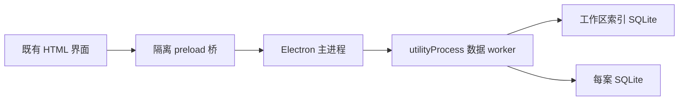

# 05 · M0 桌面骨架与交付

> 日期：2026-11-13；版本：0.1.0
>
> 本文记录 M0 的实际代码、启动方式、保存位置和检查结果。M0 只接通案件管理，不代表第一片并表闭环已完成。

后续 0.1.1 已接续 M0 加固与介绍页修复；最新行为及验收见 [06 交付记录](06-M0加固与介绍页修复交付.md)。本文保留 0.1.0 的交付证据。

## 1. 用户确认与本轮范围

用户本轮明确授权“直接开始构建”，并确认：

- 首次启动时选择案件数据目录，不固定为 `C:\FundSiftData`。
- 首版新建案件只保留“案件名称＋案件编号”两个必填字段。
- 沿用已确认的白色科技风介绍页及紧凑办公工作台。

本轮实现：Electron 桌面壳、隔离通信桥、单个 utilityProcess 数据 worker、工作区索引、每案 SQLite、新建/打开/切换、重启保存、失联/版本错误反馈及打包入口。

本轮不读取银行/微信/支付宝原件，不导入合成流水到真实库。材料解析、金额引擎、并表查询、人工复核、回源和正式导出仍按 M1～M4 接入；相应桌面页面显示当前进度，模拟写入口不开放。HTML 演示仍保留原有体验。

## 2. 运行与构建

在仓库根目录执行：

```powershell
npm ci
npm start
```

检查与产物生成：

```powershell
npm test
npm run smoke
npm run build:dir
npm run build
```

本次已生成：

- 目录产物：`dist/win-unpacked/FundSift.exe`，需保留整个 `win-unpacked` 文件夹。
- 单文件便携产物：`dist/FundSift-0.1.0-win-x64.exe`。

打包产物烟测入口：

```powershell
node scripts/smoke.cjs dist/FundSift-0.1.0-win-x64.exe
```

该命令会使用独立临时用户配置和合成案件目录，不改变日常工作区，不读取原始案件材料；检查结果及截图写入 Git 排除的 `artifacts/m0-packaged/`。程序显示窗口由本软件 Electron 创建，不使用 Codex 内置浏览器。

## 3. 首次使用与保存位置

1. 打开介绍页，点击“进入工作台”。
2. 点击“选择数据目录”，用系统目录选择框指定本机保存位置；取消选择后仍可稍后重试。
3. 新建案件，填写名称和编号。
4. 成功写库后才显示已保存；再次启动读取原工作区与案件。

案件名称最多 40 字符，编号最多 30 字符，均去除首尾空白。编号按工作区内精确字符串判重，名称可重名；没有擅自增加大小写或全半角折叠规则。后续若需要改变编号规则，须考虑既有编号兼容。

所选数据目录的结构：

```text
用户选择的数据目录/
├── workspace.sqlite          工作区案件目录索引
└── cases/
    └── <案件UUID>/
        ├── case.sqlite       单案数据库
        ├── archive/          后续导入原件副本的位置，M0 为空
        └── exports/          后续正式导出的位置，M0 为空
```

启动偏好和所选工作区路径保存在 Electron 本机用户配置中，案件数据库保存在上面所选目录。工作区路径与当前案件记录在用户配置目录的 `workspace.json`；冒烟测试用独立配置目录。M0 尚无数据目录迁移、案件编辑、归档、恢复、删除或备份界面。

## 4. 工程结构与责任



| 文件 | 责任 |
|---|---|
| [main.cjs](../code/desktop/main.cjs) | 窗口、系统目录选择、应用设置、受限 IPC 与退出协调；不执行 SQL |
| [preload.cjs](../code/desktop/preload.cjs) | 仅公开获取状态、选择目录、列表、建案和打开五个操作，不暴露文件系统或通用 IPC |
| [worker-client.cjs](../code/desktop/worker-client.cjs) | worker 生命周期、请求编号、超时与错误返回 |
| [worker.cjs](../code/desktop/worker.cjs) | worker 消息分发，限定允许的方法 |
| [storage.cjs](../code/desktop/storage.cjs) | 同步 SQLite、目录校验、建案及可恢复登记；仅数据 worker 加载 |
| [app.js](../code/prototype/app.js) | 根据桌面桥是否存在区分真实工作区与 HTML 演示，等待成功回执再更新状态 |

桌面窗口启用 contextIsolation、sandbox、禁止 Node 集成；阻止任意跳转、新窗口与 WebView，IPC 校验主页面身份。界面不能任意读取本机路径，也不能直接执行 SQL。单实例入口避免普通重复启动产生两个活动工作区写入者。

## 5. 数据设计补充

### 5.1 工作区索引与稳定身份

`workspace.sqlite` 的 `workspace_case` 保存案件 UUID、名称、编号、相对路径、创建/更新时间及最近打开时间。每案使用 UUID 子目录，案件名称和编号不拼入文件路径，避免名称冲突或路径穿越。

每案数据库执行 [03 中提取的 DDL](../code/ddl_extract_check.sql)，并附加 `desktop_case_identity` 辅助表保存该案 UUID。它不新增业务字段，用于核对库与工作区登记身份，防止同名/同编号数据库被调换后串案。工作区和案件库均设置 application_id、user_version；不兼容结构拒绝打开，不自动覆盖迁移。

M0 使用 `foreign_keys=ON`、WAL、`busy_timeout=5000`、`synchronous=FULL`。案件统计仅计同案、同文件、done 且被 current 指针选中的批次；失败或历史批次不重复计数。相关逻辑已在合成库测试，真实导入写入口尚未接入。

### 5.2 创建失败与重启恢复

案件库与工作区索引是两份数据库，不宣称跨库单事务。创建时用独占 UUID 目录及本次创建日志记录进度：先完成案件库与身份，再登记索引；崩溃后只恢复身份和结构均匹配的完整新案。冲突或不完整日志保留，不能被当作创建成功。

正常失败时只清理本次明确新建的目录，原案与用户已有文件保留。数据库失联显示“暂不可用”，计数显示未知，不建立同名空库替代；错误打开不能让新旧案件混在一起。

恢复已保存的工作区时禁用自动创建：目录、工作区索引或案件目录失联均报错，保留原路径，等待恢复后重试。同一工作区刷新保留当前数据库连接与实际打开案件。退出时等待已排队的操作和 worker 关闭完成，再结束程序。

## 6. 固定依赖与本轮环境

| 项目 | 版本/情况 |
|---|---|
| 开发 Node.js / npm | 22.20.0 / 10.9.3 |
| Electron | 42.11.18，Windows x64，原生 ABI 146 |
| better-sqlite3 | 12.11.1，使用匹配 Electron ABI 的官方预编译包 |
| electron-builder | 26.18.0 |
| jsdom | 27.4.0，仅开发检查使用 |

最新 Electron 与最新 SQLite 原生模块在本机缺少匹配预编译包，且未安装 Visual Studio C++ 工具，因此本轮固定了有匹配包的组合。曾遇到下载连接重置，改由命令行下载官方发布文件，并核对 Electron 包内 checksums 与 SQLite 发布资产 SHA256 后使用；未安装系统编译工具或更改全局运行时。

依赖锁文件已生成；运行产物、数据库、样本与依赖目录排除在 Git 之外。原生测试使用 Electron 的 Node 模式执行，避免用开发 Node 的另一套 ABI 误测。

## 7. 本轮验证与限制

| 检查 | 已观察结果 | 范围 |
|---|---|---|
| 运行脚本语法检查 | 通过 | desktop、scripts 与原型运行 JS |
| 介绍页与启动偏好 | 42 项通过 | 既有离线回归 |
| 工作台 HTML 交互 | 58 项通过 | 既有离线回归与合成导出 |
| 桌面桥合同 | 42 项通过 | mock 桥状态、错误与交互，不代替数据库验收 |
| 真实 SQLite 存储 | 15 组通过 | 建案、重开、判重、丢库、版本/身份拒绝、统计、失败清理与恢复、工作区失联不重建、刷新保留连接 |
| 开发态 Electron 烟测 | create/reopen 两阶段通过 | 隔离桥、界面建案写真实库、重复拒绝、关闭重开、演示隔离、目录移走不重建及恢复重开 |
| Windows 单文件便携 EXE | create/reopen 两阶段通过，结果中 `packaged=true` | 最终 `FundSift-0.1.0-win-x64.exe` 的原生组件、隔离桥、界面建案写库与关闭重开，含目录失联及恢复 |

开发态结果保存在 `artifacts/m0-development/create.json`、`reopen.json` 及对应截图。最终便携 EXE 于 2026-11-13 13:16（北京时间）再次通过两阶段烟测，结果与截图保存在 `artifacts/m0-packaged/`；创建阶段覆盖 9 项检查，重启阶段覆盖 10 项检查。该次检查直接启动单文件便携 EXE，不能仅用目录产物的结果代替。

测试均为独立临时目录中的合成案件；原始案件目录未读写。真实系统目录选择框的人工操作、其他电脑和其他 Windows 版本仍未在自动检查中覆盖。后续代码或依赖改变并重新打包时，须重新验证对应 EXE。

本轮不证明金额引擎正确、百万行内存性能、真实格式识别、人工历史、回源或正式导出已可用。G0 黄金样本及 M1～M4 仍需按各阶段验收；Q03～Q11 未因实现桌面壳而自动确认。

## 8. Git 提交文案

Summary：`构建M0桌面骨架并接通本地案件保存`

Description：

```text
将现有浅色界面接入Electron，新增首次目录选择和名称编号建案。
在utilityProcess接通工作区索引、每案SQLite、案件打开切换与重启保存。
隔离HTML演示与真实数据，未接入的导入、复核和导出明确显示进度。
补充真实存储、桌面桥及重启烟测，锁定依赖并交付通过烟测的Windows便携EXE。
同步Q01/Q02用户决定、使用说明与M0交付边界。
```

大白话：从“刷新就消失的演示”走到“能在电脑里真正建案和保存”的桌面骨架；处理真实流水的下一段还要按计划接上。
